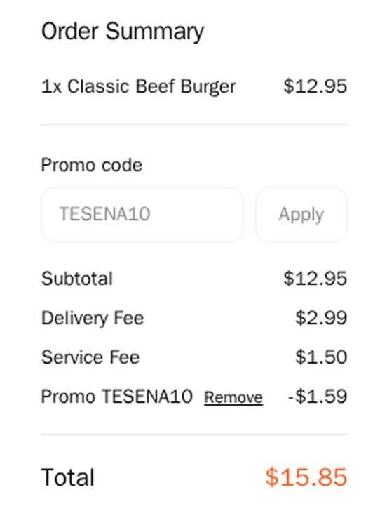
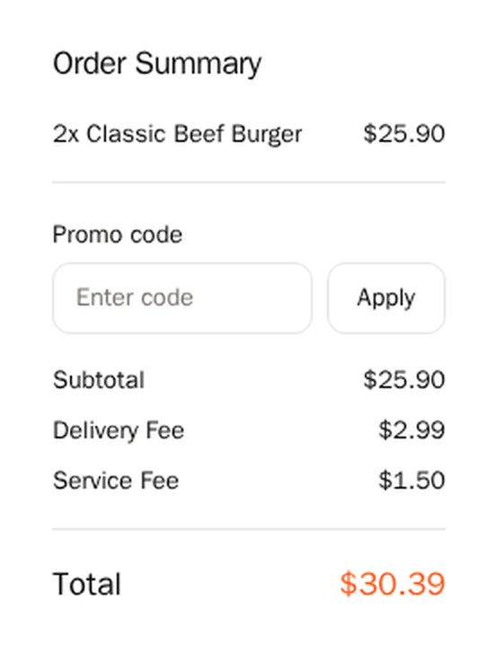
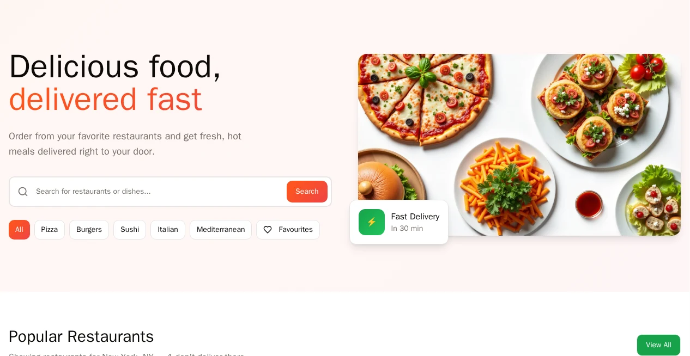

import { StatTiles, Takeaway } from "@site/src/components/blog/ai-testing-agents";

Can an AI testing agent find bugs in a vibe-coded app it has never seen? On 22 October 2026 we tried it live on YouTube. We planted 5 bugs in a food-delivery demo app, added a new feature with one prompt, and pointed the Wopee.io agent at it with a 4-line ticket and the app's business rules. Not the bugs.

It found all 5. Three with the exact steps from our answer key, two by their symptoms. Zero false alarms.

And it found one more that nobody planted.

Here is the scoreboard, how it got there, and what didn't go well.

<!--truncate-->

<div style={{ width: '100%', aspectRatio: '16 / 9', margin: '1.5rem 0', borderRadius: '12px', overflow: 'hidden', background: '#000' }}>
<iframe style={{ width: '100%', height: '100%', border: 0, display: 'block' }} src="https://www.youtube.com/embed/TI4AoWjwm8A" title="AI testing agent vs a vibe-coded app: 5 of 5 bugs found, live" allow="accelerometer; autoplay; clipboard-write; encrypted-media; gyroscope; picture-in-picture; web-share" referrerPolicy="strict-origin-when-cross-origin" allowFullScreen></iframe>
</div>

_The 19-minute replay ([youtu.be/TI4AoWjwm8A](https://youtu.be/TI4AoWjwm8A)). Every result in this post is checked on screen there._

## The setup

Code got cheap. Knowing that it works didn't.

So we built the test the way most teams meet AI-generated code today:

- **An app the agent had never seen.** A food-delivery demo app built with Lovable for our Vibe Testing Lab workshop: restaurants, a menu, a cart, promo codes, favourites, guest checkout.
- **5 planted bugs**, all about money or memory: a delivery fee that changes between the card and the cart, a promotion that never applies, a promo code that also discounts the fees, a minimum order that counts the fees, and a favourite that disappears. The full list is [public on GitHub](https://github.com/Wopee-io/tf-2026-vibe-testing/blob/main/docs/battle/answer-key.md). You can check every claim below.
- **One vibe-coded feature, live.** I added "Sort by" (rating, fastest delivery, lowest fee) to the restaurant list with one Lovable prompt and shipped it.
- **A 4-line ticket for the agent:** test the main ordering flows end to end, checkout accepts the promo code, some restaurants have a minimum order, and favourites must survive a page reload.

No hints about where the bugs were. No recorded steps. Then I started the agent and kept talking.

## The scoreboard

<StatTiles
  items={[
    { value: "5 of 5", label: "planted bugs found, counted by symptom", source: "Live run, 22 Oct 2026" },
    { value: "3 of 5", label: "found with the exact repro from the answer key", source: "Live run, 22 Oct 2026" },
    { value: "0", label: "false alarms: every failed test was a real bug", source: "Live run, 22 Oct 2026" },
    { value: "+1", label: "real bug nobody planted: \"View All\" does nothing", source: "Live run, 22 Oct 2026" },
  ]}
/>

| Metric | Live run, 22 Oct |
| --- | --- |
| Planted bugs missed | 0 |
| The vibe-coded Sort by | tested, works |
| First exploration (crawl) | 8.6 minutes, 28 steps |
| Tests run | 11 (4 passed, 7 failed, every failure a real bug) |

"By symptom" means the agent found real evidence of the bug, but through a different path than our answer key. Two examples follow. If you only count exact repros, the live score is 3 of 5. In the rehearsal project earlier the same day, the same setup reached all 5 with the exact steps. That was the rehearsal, not the show, so the headline above is the live number.

## What it found, bug by bug

**1. The promo code discounts the fees too.** TESENA10 should take 10% off the food. On a $12.95 burger the agent computed −$1.30 and a total of $16.14. The checkout said −$1.59 and $15.85. The order confirmation repeated $15.85. Both assertions failed, with every number on one screen.



**2. The promotion never applies.** One restaurant advertises "20% OFF orders over $25". The agent built a $25.90 cart and expected $25.21. It was charged $30.39. It also checked $24.98 (correctly no discount), so we know where the bug starts.



**3. The fee on the card isn't the fee you pay** (by symptom). One restaurant's card says $3.49 delivery, another says $1.99. The cart charges $2.99 for both. Our answer key describes this bug through a third restaurant marked "Free". The agent found the same flat $2.99 elsewhere.

**4. The minimum order counts the fees** (by symptom). The sushi place has a $20 minimum. The agent's $19.98 cart went straight to checkout with no "add $X more" message. The fees pushed it over the line, which is exactly the planted bug, seen from the outside. The answer key's repro is the wrong shortfall amount, which the live run didn't see.

**5. A favourite that vanishes.** More on this one below, because it's the most instructive.

## The bug nobody planted

During its first exploration, before I gave it any rules, the agent clicked "View All" on the restaurant list twice. Nothing changed. It checked that the button has no handler and no link, and reported it. Then it wrote a test for it, which failed a minute later.

On stream, I opened the app and clicked it myself. Nothing.

We hadn't planted it. It came with the app.

[](./view-all-inert.webp)

This is the split I want: the agent reports, with evidence, and a human confirms in 30 seconds.

## Why it worked: rules, not bugs

The 4-line ticket got the agent exploring. What made the difference was the project context I added after the crawl. Three parts:

1. **Business rules from the spec.** How prices, fees, discounts and totals must add up. Minimum orders. That one restaurant doesn't deliver to the test address, by design.
2. **A method in three phrases.** Follow the money: compute every price, fee, discount and total. Push the limits: just below and just above every threshold. Check what sticks: what you saved must still be there after a reload.
3. **A test format with a fail condition.** Every test states a goal, what makes it pass, and what makes it fail.

Then one chat prompt: "What else should a careful tester check in this shop before release? Propose five tests." The agent proposed five in under 20 seconds. I accepted all five and asked for one more for the Sort feature.

The third part matters more than it looks. Agents assume. If you don't tell an agent when to fail, it will find a reason to pass. Here is the shape of one test the agent ran:

```text
Goal:     TESENA10 discounts food only
          and matches the confirmation total.
Data:     1x Classic Beef Burger, guest checkout,
          promo code TESENA10.
Pass if:  Discount = 10% of the food subtotal;
          checkout total = confirmation total.
Fail if:  The discount includes delivery or
          service fees, or the totals differ.
```

No click paths. No selectors. The agent finds the way. The rules decide the verdict.

<Takeaway>Give the agent the spec's rules, not the bugs. And always tell it when to fail.</Takeaway>

## The bug a happy-path test blesses

The crawl wrote its own favourites test: save one restaurant, reload, check it's still saved. It passed.

The method test, "favourite every restaurant and verify after reload", failed. The Favourites filter showed 4 of 5. One restaurant was missing, and its heart flipped back to empty after a reload.

The cause, from our answer key: four restaurants have numeric IDs, and one has a text slug. The app stores favourites as numbers, and `Number("koliba-u-jana")` is `NaN`. A test written against one restaurant will be green forever.

This is the bug I'd show any team that vibe-codes features. The code works for the example in the prompt. It breaks on the first case the prompt didn't mention. A test only finds it if it generalises, and "check what sticks, for every item" is how you ask for that in one line.

## What didn't go well

An honest scoreboard includes our side.

- **It was slower than it had to be.** Live, the six method tests ran one after another, about 32 minutes. In the rehearsal earlier that day they ran in parallel, in about 5. The last planted bug came in at 18:35, after the Q&A. Not "found in 30 minutes".
- **Two of five by symptom.** The agent found real evidence for both bugs, but not through the repro in our answer key.
- **It didn't always follow my instruction.** I asked for the Sort test as a description without recorded steps. The first version came with steps and needed a second prompt.
- **One confusing chat message.** Mid-run, the chat said it couldn't access the test inventory, so it couldn't report the status. The tests ran fine. The message was wrong, and we're fixing it.
- **Two passes our own gate questioned.** The Sort test and the one-restaurant favourites test passed, and both passes look right in the reports. Our verdict gate still marked them incomplete: the Sort test read the ratings from screenshots instead of asserting them, and one favourites click changed nothing because the filter was already on. The gate only reports for now. A pass you can't fully explain is worth a second look, even when it's right.
- **It told me what it couldn't test.** The boundary tests wanted carts of exactly $19.99 and $20.01. The menu prices can't add up to those. The agent said so and labelled it a test limit, not a bug. That isn't a failure, but it's worth knowing: boundaries need data you can actually build.

## How to test your own vibe-coded app

You don't need our tool to steal the method. Before you ship the next prompt-built feature:

1. **Write down the rules, not the steps.** Prices, limits, permissions, what must persist. One page is plenty.
2. **Follow the money.** Recompute every total yourself, including fees and discounts. Most of our planted bugs were arithmetic.
3. **Push the limits.** Test just below, at, and just above every threshold you find.
4. **Check what sticks, for every item.** Save, reload, navigate away and back. Do it for all items, not the one in the prompt.
5. **Give every test a fail condition.** Then make whoever runs it, human or agent, prove the pass.

## FAQ

**Can an AI testing agent test a vibe-coded app it has never seen?**
Yes. In this run it explored the app in 8.6 minutes without any test scripts, wrote tests from a 4-line ticket and a page of business rules, and found 5 of 5 planted bugs (3 with the exact repro) with 0 false alarms.

**Did the agent know where the bugs were?**
No. It got the app's rules and a testing method, not the bug list. The bug list is public on GitHub, so you can compare its findings yourself.

**Does an AI agent replace human testers here?**
No. It did the arithmetic and the repetition. I wrote the rules, chose the method, and confirmed the unplanted bug by hand. That division of work is the point.

## Next: Build & Break #2, Tue 10 Nov

This show tested an app. The next one tests the tests. Before the show, a coding agent writes 100 Playwright tests for the same demo app, all green. On **Tue 10 Nov 2026, 17:30 CET** we ship a refactor with 5 planted bugs and count how many tests stay green: **"100 Playwright tests, 5 planted bugs. How many stay green?"** You guess the number first. Same rules as this time: the count is published as measured, misses included. 55 minutes, free, live on YouTube. [Register on LinkedIn](https://www.linkedin.com/events/7519978225712910336/).

Want to try it on your own app first? Paste a URL into [Wopee.io](https://cmd.wopee.io/) and the agent starts exploring. The Free plan is enough for a first crawl and its tests. [Pricing](/pricing/).

More reading: [AI testing agents: hype, reality and 5 tools compared](/blog/ai-testing-agents/) · [Vibe coding, vibe testing and vibe engineering](/blog/vibe-testing-coding-engineering/) · [Test design techniques for web apps](/blog/test-design-techniques/) · [How to start with AI in QA](/blog/how-to-start-with-ai-in-qa/) · [Vibe Testing Lab: 4 AI testing agents on one app](/videos/vibe-testing-lab-ai-testing-agents/)

## Sources

1. Build & Break replay, 22 Oct 2026: [youtu.be/TI4AoWjwm8A](https://youtu.be/TI4AoWjwm8A). Full live recording: [youtube.com/live/NccOkZMIaVE](https://youtube.com/live/NccOkZMIaVE).
2. Planted bugs and how to reproduce them: [answer key on GitHub](https://github.com/Wopee-io/tf-2026-vibe-testing/blob/main/docs/battle/answer-key.md).
3. Run data: Wopee.io production runs for the live project, 22 Oct 2026, 17:34 to 18:35 CEST.

_Full disclosure: I build Wopee.io. The bugs were planted by us, the list was public before the show, and the scoreboard counts both ways._
