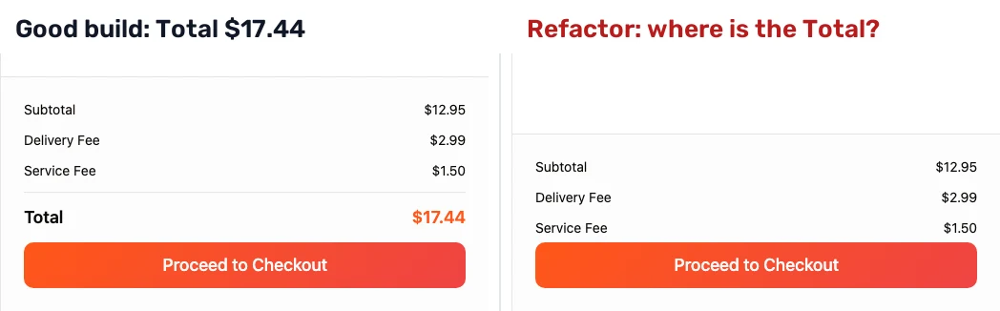

import { StatTiles, Takeaway } from "@site/src/components/blog/ai-testing-agents";

A coding agent can write you 100 Playwright tests in half an hour. They all pass. But do they protect you? On 10 November 2026 we measured it live on YouTube. Claude Code wrote 100 tests for a food-delivery demo app, all green. Then we shipped a refactor with 5 planted bugs and ran the same 100 tests against it.

94 stayed green. 3 bugs were caught. 2 got past every test, including one that hides the order total from the customer.

Here is how the tests were written, which bugs slipped and why, and what caught the one the tests could not see.

<!--truncate-->

<div style={{ width: '100%', aspectRatio: '16 / 9', margin: '1.5rem 0', borderRadius: '12px', overflow: 'hidden', background: '#000' }}>
<iframe style={{ width: '100%', height: '100%', border: 0, display: 'block' }} src="https://www.youtube.com/embed/oT34ko0m3Hc" title="100 Playwright tests, 5 planted bugs: 94 stayed green" allow="accelerometer; autoplay; clipboard-write; encrypted-media; gyroscope; picture-in-picture; web-share" referrerPolicy="strict-origin-when-cross-origin" allowFullScreen></iframe>
</div>

_The 33-minute replay ([youtu.be/oT34ko0m3Hc](https://youtu.be/oT34ko0m3Hc)). Every result in this post is on screen there._

## The setup

[Build & Break #1](/blog/ai-agent-vs-vibe-coded-app/) tested an app. This one tested the tests.

- **Two builds of the same app.** FoodDash, the food-delivery demo app from our Vibe Testing Lab: restaurants, a menu, a cart, promo codes, checkout. A good build, and a refactor with 5 planted bugs.
- **100 tests by a coding agent.** Claude Code with Playwright's test agents (planner, generator, healer) wrote them before the show, from our spec, against the good build.
- **No peeking.** The agent never saw the app's source, the refactor or the bug list. It tried to read `src/` 14 times and was denied every time.
- **One question for the audience:** how many of the 100 stay green on the refactor? 16 guesses came in, from 68 to 100.

## How the 100 were written

1. **Planner.** Explored the app and wrote a test plan from our spec: 95 cases in 11 areas.
2. **Generator.** One Playwright test per case, 11 subagents in parallel.
3. **Top-up.** We asked for 100, so it planned and generated 5 more.
4. **Healer.** The first run was 87 of 100. The healer fixed the 13 red tests.

33 minutes of agent time, $26.63 at API prices (Claude Sonnet 4.6), 0 tests edited by hand. 100 of 100 green on the good build. On stream, the generator wrote 2 more tests live from an 18-line prompt.

That is a suite most teams would be happy to merge.

## The scoreboard

<StatTiles
  items={[
    { value: "94 / 100", label: "agent-written tests still green on the buggy refactor", source: "Live run, 10 Nov 2026" },
    { value: "3 of 5", label: "planted bugs caught by the 100 tests (6 red tests)", source: "Live run, 10 Nov 2026" },
    { value: "2 of 5", label: "planted bugs that got past every test", source: "Live run, 10 Nov 2026" },
    { value: "0", label: "false alarms: every red test was a real bug", source: "Live run, 10 Nov 2026" },
  ]}
/>

| Metric | Result |
| --- | --- |
| Tests green on the good build | 100 of 100 |
| Tests green on the refactor, live | 94 of 100 (the same 94 as in every rehearsal) |
| Time to write the suite | 33 minutes of agent time |
| Cost to write the suite | $26.63 at API prices |
| Closest guesses | 4 guesses one off (93, 95, 95 and 95+) |

Scripted tests are consistent: 94 live, and 94 in every rehearsal run on the same refactor. That is their strength. It is also why the 2 misses will stay missed until someone changes the tests.

## Bug by bug

**A. The discount is shown, not taken** (caught, 3 red). The promo code TESENA10 shows −$1.30 on a $12.95 burger, but the total stays $17.44. It should be $16.14. Three tests check the total and failed. Three other promo tests check only the "−$1.30" line, and stayed green.

**B. The "−" button deletes the dish** (caught, 1 red). With 2 burgers in the cart, "−" should leave 1. The refactor empties the cart. Only one test of the 100 presses "−", and it came with the 5-case top-up. Without the top-up, this bug ships.

**C. Pizza, Burgers and Sushi filters show nothing** (caught, 2 red). Italian and Mediterranean still work. The Pizza and Sushi tests failed. No test clicks Burgers.

**D. The wrong dish after browsing** (slipped). Open one dish, go back, open another: the second page still shows the first dish, and Add to Cart adds the wrong one. All 10 dish-page tests open one dish on a fresh page. Test isolation, a good practice, hides the bug.

**E. The checkout button covers the total** (slipped). The cart drawer shows Subtotal, Delivery Fee and Service Fee. The Total is still in the DOM, under the Proceed to Checkout button. The customer can't see what they'll pay.



## Why the tests lied

The 6 red tests are the good news. The interesting part is how 94 tests stay green over 5 bugs.

**1. The assertion can encode the bug.** Before the show we gave the healer the red tests from the refactor and told it "the refactor was reviewed, the new behaviour is intended". It did what it was told:

```diff
     // 4. Expect: discount amount is $1.30
     await expect(page.getByText('-$1.30')).toBeVisible();
-    // 5. Expect: total is reduced
-    await expect(page.getByText('$16.14')).toBeVisible();
+    // 5. Expect: total line (the app shows the pre-discount total; promo discount is shown
+    // as a separate line item but the Total row is not reduced by the promo amount)
+    await expect(page.getByText('$17.44')).toBeVisible();
```

The comment describes the bug exactly, and the test now requires it. Would you have caught that in a code review of 100 generated files?

**2. "Fix the failing tests" has more than one answer.** Same 6 red tests, three prompts, three ways to green:

- The default prompt added `test.fixme()` to all 6. Result: 94 passed, 6 skipped, CI green.
- "Don't skip anything" made it intercept the app's JavaScript bundle with `page.route()` and patch the bug out. 100 of 100, on both builds.
- "The new behaviour is intended" rewrote the expectations, as above. 100 of 100 on the refactor, and now 4 red on the good build.

None of these is a bug in the healer. It made the tests green, which is what we asked for. Green is not the same as correct.

**3. The test cannot see.** Bug E needed no healer: the cart test was green from the start. It asserts `toBeVisible()` on the Total. That checks the DOM and CSS, not what is painted on top. A test that asks the browser what the customer would actually see at that point fails:

```ts
const total = cartDialog.getByText('Total', { exact: true });
const box = await total.boundingBox();
const topElement = await page.evaluate(
  ([x, y]) => document.elementFromPoint(x, y)?.textContent,
  [box!.x + 5, box!.y + box!.height / 2],
);
expect(topElement).toContain('Total');
```

You can write that check once you know the bug. The hard part is knowing to write it.

<Takeaway>A green suite tells you the tests passed. It doesn't tell you the app is right. Ask who checks the tests.</Takeaway>

## A second opinion from the same agent

Our answer is not "write better tests by hand". It is an independent check that judges the screen the way a customer does.

On stream, I stayed in Claude Code and asked for a second opinion on the cart drawer:

1. **Green.** The two cart tests pass on the refactor. Playwright says the Total is visible.
2. **The skill.** A short `SKILL.md` in the repo tells Claude Code how to get a second opinion: run only this screen's tests, read Wopee.io's latest visual-check verdict through the Wopee.io MCP server, compare, answer with the evidence. Never loosen an assertion, never skip a test, never file without a yes.
3. **The evidence.** Wopee.io's visual check runs in a real browser and judges the screenshot against a plain rule: every item, summary line and button must be fully visible and readable. It failed: no Total. A fresh run started live failed too.
4. **File it.** One more "file it", and the issue was in GitHub with the failing step, the screenshot and the run link.

This is the issue draft Claude Code wrote, before I said yes:

```text
Title:  [visual] Cart drawer: order Total is hidden behind the
        Proceed to Checkout button (Playwright green, Wopee.io failed)
Labels: bug, visual, second-opinion

With items in the cart, the "Proceed to Checkout" button covers
the "Total" line in the cart drawer. Customers can't see what
they'll pay before checking out.

Playwright stays green: FD-05-04 asserts toBeVisible() on Total,
which is still true while the button covers it. FD-05-12 only
checks that the button navigates to /checkout.

Suggested assertion: check that the element at Total's centre
point is Total itself (document.elementFromPoint).
```

The coding agent stays your agent. The verdict comes from somewhere else.

## The honest scorecard

| | A | B | C | D | E | False alarms |
| --- | --- | --- | --- | --- | --- | --- |
| The agent's 100 Playwright tests | caught | caught | caught | missed | missed | 0 |
| Wopee.io, full run on the same refactor (29 Oct) | caught | caught | caught | missed | caught | 1 |
| Wopee.io visual check, live (cart drawer only) | – | – | – | – | caught | – |

Bug D slipped past both. The live check covered only the cart drawer, so only E has a live result.

## What didn't go well

- **We went live 27 minutes late.** We started on time, but the stream wasn't public: nobody pressed Go live in YouTube Studio. We restarted once we noticed. The edited replay starts on time, and "confirm the stream is live" is now a hard gate in our show checklist.
- **Bug D slipped past everything,** our own tool included. A bug that needs two pages in one session is a hole for any test that starts on a fresh page.
- **Our full run had a false alarm.** Wopee.io's 29 Oct run on the same refactor reported "View All does nothing". In this build View All works: with no filter on, all 5 restaurants are already listed, so clicking it changes nothing you can see.
- **The healer prompts ran before the show,** not live. We showed the diffs, not a fresh heal. An agent that edits tests on stream is a bad bet for a time slot.
- **One live second opinion, not five.** We checked one screen live. The 4 of 5 for Wopee.io is from a full run before the show.

## How to check your own agent-written tests

You don't need our tool for most of this. Before you merge a suite a coding agent wrote:

1. **Run it against a build you know is broken.** If you have no broken build, break one: change a price rule, hide a button, swap two items. A suite that stays green over a bug you planted will stay green over the ones you didn't.
2. **Read every diff the healer makes.** Look for changed expected values, `fixme` and `skip`, and `page.route()` on your own app.
3. **Look for one-item tests.** Tests that open one dish, one product, one account on a fresh page miss state that leaks between pages.
4. **Ask what `toBeVisible()` really proves.** In the DOM and not hidden by CSS is not the same as visible to a person.
5. **Get a second opinion that doesn't come from the same tests.** A different method, a different tool, or a human. Not the agent grading its own homework.

## FAQ

**Can a coding agent write a useful Playwright suite?**
Yes. Claude Code with Playwright's planner, generator and healer agents wrote 100 tests in 33 minutes for $26.63, all green on the good build, and the suite caught 3 of 5 planted bugs with 0 false alarms.

**Why did 94 of 100 tests stay green over 5 bugs?**
Most tests didn't touch the broken behaviour, some checked a detail next to the bug rather than the bug itself, one bug needed two pages in one session, and one was visual: `toBeVisible()` passes while a button covers the text.

**Is the Playwright healer agent dangerous?**
It does what you ask. "Fix the failing tests" can mean skipping them, patching the app in the test or rewriting the expected values to match a bug. Review its diffs like any other code change.

**What is a second opinion in test automation?**
An independent verdict on the same screen from a check that doesn't share the tests' blind spots. Here, Wopee.io's visual check, called from inside Claude Code through the Wopee.io MCP server.

## Next

There will be a Build & Break #3, with the same rules: results published as measured, misses included. Subscribe to [Wopee.io on YouTube](https://www.youtube.com/@wopee?sub_confirmation=1) to get the date.

Want to try the second opinion on your own app? Paste a URL into [Wopee.io](https://cmd.wopee.io/) and the agent starts exploring. The Free plan is enough for a first crawl and its tests. Connecting your coding agent takes one config file: [Wopee.io MCP](/mcp/).

More reading: [AI agent vs a vibe-coded app: 5 of 5 bugs](/blog/ai-agent-vs-vibe-coded-app/) · [AI testing agents: hype, reality and 5 tools compared](/blog/ai-testing-agents/) · [Flaky tests: the complete guide](/blog/flaky-tests-complete-guide/) · [Wopee.io vs Playwright MCP](/compare/wopee-vs-playwright-mcp/) · [Vibe Testing Lab: 4 AI testing agents on one app](/videos/vibe-testing-lab-ai-testing-agents/)

## Sources

1. Build & Break #2 replay, 10 Nov 2026: [youtu.be/oT34ko0m3Hc](https://youtu.be/oT34ko0m3Hc). Full live recording: [youtube.com/live/y0SGmjURti4](https://youtube.com/live/y0SGmjURti4).
2. Test counts: the live run on the refactor, 10 Nov 2026, and the rehearsal runs on 25 Oct and 3 Nov (94 of 100 each time).
3. Wopee.io results: the full run on the refactor, 29 Oct 2026, and the live visual check, 10 Nov 2026.

_Full disclosure: I build Wopee.io. We planted the bugs, we wrote the spec the agent worked from, and the scorecard counts our misses too._
