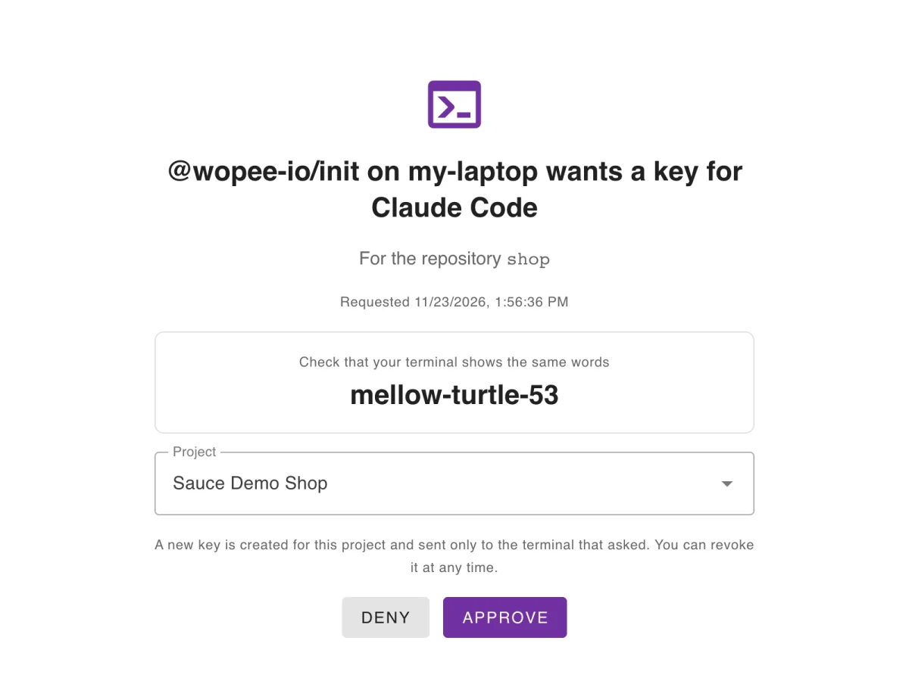

import { SetupLine } from "@site/src/components/blog/one-prompt-setup";

In March, AI agents opened 17% of the pull requests GitHub could attribute to them. By September it was more than 40%: 110 million pull requests in one month that started as an agent's first draft ([GitHub Octoverse 2026](https://github.blog/news-insights/octoverse/octoverse-commits-pushes-reach-new-highs-in-2026-as-developers-build-with-agents/)).

Writing code got cheap. Checking it did not.

<!--truncate-->

{/* LAUNCH DAY: YouTube embed of the launch film goes here. Replace VIDEO_ID, check the title, then uncomment the block below.

<div style={{ width: '100%', aspectRatio: '16 / 9', margin: '1.5rem 0', borderRadius: '12px', overflow: 'hidden', background: '#000' }}>
<iframe style={{ width: '100%', height: '100%', border: 0, display: 'block' }} src="https://www.youtube.com/embed/VIDEO_ID" title="One prompt: set up Wopee.io from your coding agent" allow="accelerometer; autoplay; clipboard-write; encrypted-media; gyroscope; picture-in-picture; web-share" referrerPolicy="strict-origin-when-cross-origin" allowFullScreen></iframe>
</div>

*/}

In one vendor survey, 96% of developers said they don't fully trust that AI-generated code is correct, and only 48% said they always check it before they commit ([Sonar](https://www.sonarsource.com/company/press-releases/sonar-data-reveals-critical-verification-gap-in-ai-coding/)). Anthropic's own guide for Claude Code says it out loud: if the agent has nothing to run that tells it whether the work is done, "that makes you the test suite".

We think that's backwards. You shouldn't be the test suite. The agent should have a tester it can call, and it should be able to set that tester up on its own.

Starting today, it can.

## One prompt, one approval

Open your repo in Claude Code or another coding agent and paste this line:

<SetupLine position="top" />

That's the setup. No dashboard tour, no copied key, no JSON to edit.

The link points to a public setup guide written for agents. It is plain Markdown, and you can read the same steps at [wopee.io/agent-setup](https://wopee.io/agent-setup/?utm_source=blog&utm_medium=post&utm_campaign=one-prompt-setup). The rest of the line keeps you in charge: the agent shows you its plan and waits for your yes.

No account yet? [Sign up first](https://cmd.wopee.io/signup), then paste the line. A project admin approves the connection.

## What happens next, in a real session

Everything below is quoted from a Claude Code session on a small shop repo. Nothing is mocked up; lines that don't matter here are cut and marked `…`.

**1. The agent checks the repo and shows you the plan.** It runs read-only checks (Node.js version, `.gitignore`, any existing setup), then asks before it touches anything:

```text
⏺ Answered Claude's questions:
  ⎿  · Wopee.io setup plan: run `npx -y @wopee-io/init@latest --agent
     claude-code` in the shop repo. It will start a pairing link that
     you approve in Wopee Commander, then write WOPEE_API_KEY and
     WOPEE_PROJECT_UUID to .env, add .env to .gitignore, and create
     .mcp.json with a 'wopee' server (no key in it). How should I
     proceed? → Run it (Recommended)
```

**2. It runs one command, and you get a link and pairing words.** [`@wopee-io/init`](https://www.npmjs.com/package/@wopee-io/init) is open source. It prints a link to Commander and the pairing words, then hands control back to the agent so it can show you both:

> Approve this setup in Wopee.io Commander. Check that it shows the same words: mellow-turtle-53

**3. You approve in Commander.** Open the link, check that the words match, pick the project and click Approve.



**4. The command finishes the setup, and the agent tells you what changed:**

```text
  Files the setup changed:
  …
  - .gitignore: now lists .env.
  - .mcp.json (new): adds a wopee server that runs npx -y
    wopee-mcp@latest. It contains no key, so it's safe to commit.

  I haven't committed anything.
```

**5. Restart the agent and check the connection.** After the restart, ask it to check the setup. It makes one read-only call:

```text
  - Connection check: this read-only check passed.
    - Project: Sauce Demo Shop (8b84d1d8-5bfd-4036-9ca4-a45bd569e967)
```

The approval stays with you by design: the agent proposes, you approve. Undoing it is short too, and the agent said how in the same session:

```text
  To undo: claude mcp remove wopee --scope project, then delete .env and
  the .env line in .gitignore.
```

## No key in the chat, no key in any config

Most MCP setup guides tell you to paste an API key into a config file. Those files get committed. GitGuardian counted 24,008 secrets in MCP config files on public GitHub, and 2,117 of them still worked ([State of Secrets Sprawl 2026](https://blog.gitguardian.com/the-state-of-secrets-sprawl-2026/)).

We built the setup so that never has to happen. Here is how `npx -y @wopee-io/init --help` (version 1.3.2) puts it:

> Prints a link and pairing words. You approve in Wopee.io Commander, and a new, named project API key comes back encrypted to this process: nobody copies it, and it never passes through a coding agent's chat. Then it writes a git-ignored .env and a key-free `wopee` MCP server for your agents.

In practice:

- The key is created when you approve, for one project, and named after the agent and machine that asked for it. You can revoke it in Commander at any time.
- It goes encrypted to the command on your machine. It never passes through the agent's chat.
- It lands in a git-ignored `.env`. The `wopee` MCP entry holds no key at all, so it is safe to commit and share with your team.

## Then give it the real work

Setup is the boring part. This is the part we care about:

```text
Run a Wopee analysis of https://your-app.example
```

Your coding agent calls the Wopee.io MCP server. Wopee.io's own testing agents open your app in a real browser, explore it like a person would, write user stories and test cases, run them and come back with a verdict and the evidence behind it. Your agent reads the result and fixes what broke. Runs use your plan's steps, so the agent asks before it starts one.

Playwright MCP gives your agent a browser to drive step by step. The Wopee.io MCP server gives it a tester. That matters, because the agent that wrote the code is the wrong one to grade it.

## Built for agents as much as for people

This is where we are taking Wopee.io. Testing is becoming something you ask for, not something you assemble. So every part of the product has to work for two kinds of users: the person who decides what matters, and the agent that does the work.

For people: Commander, where you see every run, every verdict and the proof behind it.

For agents: one prompt to get in, a setup guide they can read as Markdown, tools that answer in plain next steps, and errors that say what to do next.

A fair warning, because we'd want one. Agent-run tests are slower and cost more than a script, so they don't replace your regression suite. And some decisions stay yours on purpose: approving a verdict, a baseline or a schedule still happens in Commander.

But getting started is now one line. Open your repo and paste it into your coding agent:

<SetupLine position="bottom" />

[See how it works](https://wopee.io/agent-setup/?utm_source=blog&utm_medium=post&utm_campaign=one-prompt-setup) · [Read the docs](https://docs.wopee.io/agent-setup/?utm_source=blog&utm_medium=post&utm_campaign=one-prompt-setup)
